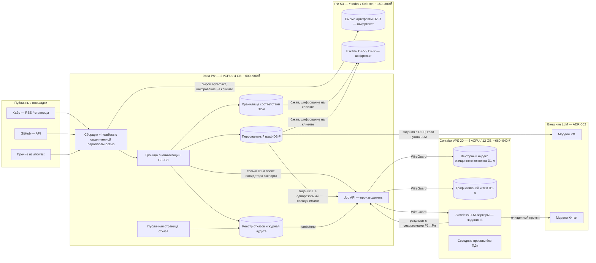

# RFC: Lean Global Compliance — анонимизация на границе и дешёвый гибрид РФ + зарубежный VPS

## RFC Metadata

| Field | Value |
| --- | --- |
| Owner | G-Ivan-A |
| RFC status | proposed — требует решения фаундера и проверки юристом перед масштабированием |
| Source issue | [#46](https://github.com/G-Ivan-A/aether-orbis/issues/46) |
| Impacted artifacts | [ADR-007](../adr/2026-10-adr-007-multi-project-deployment-topology.md) п. 2–3 и 5, [ADR-003](../adr/2026-08-adr-003-infrastructure.md) п. 3, [ADR-002](../adr/2026-08-adr-002-model-routing.md) (вызовы LLM), [ADR-004](../adr/2026-09-adr-004-preservation-policy.md) (место хранения сырых артефактов), [`docs/architecture.md`](../architecture.md) § 8, [`docs/roadmap.md`](../roadmap.md) фаза 5 и реестр рисков, [`SECURITY.md`](../../SECURITY.md) |
| Decision record | [ADR-009](../adr/2026-10-adr-009-edge-anonymization-and-lean-hybrid.md) — подклассы ПДн, размещение, граница анонимизации, отказ субъекта, триггеры |
| Evidence | [анализ правовых норм и цен](../analysis/2026-10-23-lean-global-compliance-research.md) |
| Implementation link | not yet — код, конфигурации и скрипты развёртывания запрещены hard ban #46 и выносятся в задачу реализации |
| Archetype scope | multi — AetherOrbis (C) и соседние проекты общей платформы ADR-007 |

> **Дисклеймер.** Документ — архитектурная интерпретация 152-ФЗ, GDPR и CCPA для проектирования
> системы, а не юридическая консультация. Он использует известные исключения законов настолько,
> насколько позволяет их текст, и явно помечает трактовки «на грани». Перед масштабированием,
> регистрацией юрлица, монетизацией данных, сбором контактов или при первом обращении регулятора
> выводы проверяет юрист. Ссылки на нормы и редакции — в
> [анализе](../analysis/2026-10-23-lean-global-compliance-research.md).

## Summary

Фаундер — физическое лицо в РФ, бюджет — около 1 000 ₽/мес. Нужны тяжёлые вычисления на дешёвом
зарубежном VPS (Contabo) и при этом соблюдение 152-ФЗ, GDPR и CCPA для публичных
профессиональных данных людей из РФ, США, ЕС и Казахстана.

RFC проверяет исходную схему фаундера и находит в ней три ошибки:

1. правового исключения «ст. 8 ч. 1» для публичных данных нет;
2. токенизированный граф по 152-ФЗ остаётся базой ПДн;
3. шифрование на зарубежном клиенте не делает сбор «первичной записью в РФ».

Предлагается схема **H1 «РФ-граница + зарубежные вычисления»**:

- **узел РФ** за 555–900 ₽ собирает страницы, сразу отделяет и токенизирует идентификаторы, хранит
  ключи, хранилище соответствий, персональный граф и реестр отказов;
- **РФ S3** за 150–300 ₽ хранит зашифрованные на клиенте сырые артефакты и бэкапы;
- **Contabo** за 660–940 ₽ получает только агрегаты, контент без идентификаторов и задания с
  одноразовыми псевдонимами и делает на них тяжёлую работу.

Итого **~1 400–2 150 ₽/мес**. Это в 2–3 раза дешевле «полного РФ-хоста» из оценки фаундера, и
каждая запись об отдельном гражданине РФ при этом остаётся в РФ.

Правовая опора режима:

- **ст. 6 ч. 1 п. 9** 152-ФЗ — исследовательские цели при обязательном обезличивании (граница
  анонимизации — это условие самого основания);
- **ст. 18 ч. 4 п. 4** — освобождение от уведомления каждого субъекта;
- **ст. 10.1 ч. 14** — отказ субъекта исполняется за 3 рабочих дня.

## Motivation

Issue #46 требует снять конфликт «бюджет против соответствия». После
[ADR-007](../adr/2026-10-adr-007-multi-project-deployment-topology.md) остались два разрыва.

1. **Бюджет.** ADR-007 выбирает для ступени 0 вариант A (всё в РФ, 3 200–4 500 ₽/мес за общий хост
   трёх проектов) и откладывает гибрид C2 до триггера T-COST. Для AetherOrbis, который собирает
   профили людей, C2 бесполезен: всё ценное в нём — D2. Значит, по ADR-007 AetherOrbis навсегда
   привязан к дорогому РФ-хосту.
2. **Классы данных слишком грубые.** ADR-007 относит к D2 любой профиль человека. Не различаются
   три вещи: имя в хранилище ключей, токенизированная связь «токен — компания — навык» и
   агрегат «в компании X 14 инженеров по Rust». Между ними — разный правовой режим и разная цена
   размещения.

Новый вход — диалог фаундера (приложение к issue). В нём предложена схема «Contabo для вычислений +
шифрование на клиенте + РФ S3 для ключей + граф из токенов». Её надо разобрать, исправить и
оформить так, чтобы её можно было реализовать без юриста на MVP и проверить юристом при
масштабировании.

## Goals and Non-goals

**Goals**

- Ответить на правовые вопросы issue #46 (§ 1) со ссылками на нормы и с явными зонами риска.
- Дать пошаговую схему дешёвого гибрида с обоснованием легитимности каждого шага (§ 2–4).
- Описать модуль «Anonymization at the Edge» (§ 4) и механизм отказа и удаления (§ 6).
- Дать чек-лист MVP (§ 8) и измеримые триггеры перехода на полный РФ-хостинг (§ 9).
- Сохранить совместимость с ADR-004 (сохранение сырых артефактов) и ADR-007 (классы данных,
  изоляция) — уточнить, а не сломать.

**Non-goals**

- Код, конфигурации, скрипты, схемы БД, выбор конкретных библиотек NER — hard ban #46.
- Юридическое заключение, тексты политики и уведомлений РКН — их готовит фаундер или юрист.
- Сбор контактов, прямой outreach, продажа данных о людях — это вне режима п. 9 и запускает
  триггер (§ 9).
- Корпоративные решения: выделенные серверы РФ дороже 10 000 ₽/мес, DLP-комплексы, аттестованные
  ГИС — hard ban #46.

## Proposal

### 1. Правовой анализ: ответы на вопросы issue #46

#### 1.1. Применяется ли 152-ФЗ к публичным профессиональным данным граждан США / ЕС / РК, если оператор — физлицо в РФ?

**Да.** Аргументы и нормы — в [анализе § 2.1](../analysis/2026-10-23-lean-global-compliance-research.md#21-сфера-действия).

- Исключение «для личных и семейных нужд» (ст. 1 ч. 2 п. 1) не подходит: аналитика рынка и граф
  профессиональных связей — не личная нужда.
- Закон не делит субъектов по гражданству. Основания, цели, права субъекта и уведомление РКН
  применяются ко всем.
- **Локализация** (ч. 5 ст. 18) касается только граждан РФ. По гражданам США, ЕС и РК 152-ФЗ не
  запрещает хранить записи за рубежом, но там действуют их собственные режимы (§ 1.2) и
  трансграничная передача по ст. 12.
- Гражданство автора на Хабре или GitHub почти никогда не известно. Поэтому инженерное правило
  **fail-closed**: неизвестная юрисдикция приравнивается к гражданину РФ.

Масштаб ответственности физлица: штрафы по КоАП 13.11 для гражданина — от 2 до 100 тыс. ₽, а
не миллионы, как для юрлица
([анализ § 2.7](../analysis/2026-10-23-lean-global-compliance-research.md#27-ответственность-физлица-оператора)).
Главные риски — блокировка ресурса, перенос риска на будущее юрлицо и уголовная ст. 272.1 УК при
работе с **незаконно полученными** данными. Последнее закрывается запретом на обход защит и на
слитые базы.

#### 1.2. GDPR и CCPA — коротко

| Режим | Применяется ли к MVP | Что требуется | Как закрывается архитектурой |
| --- | --- | --- | --- |
| **GDPR** | вероятно да для субъектов из ЕС: профилирование профессиональной активности — «мониторинг поведения» (Art. 3(2)(b)) | основание Art. 6(1)(f) с документированной оценкой баланса (LIA); публичное уведомление (Art. 14(5)(b)); удаление и возражение (Art. 17, 21) в течение месяца; без специальных категорий (Art. 9) | та же граница анонимизации, тот же реестр отказов, SLA 3 рабочих дня строже месяца GDPR; специальные категории блокируются на границе (G4) |
| **CCPA / CPRA** | **нет** на MVP: физлицо без выручки ниже порогов «business»; публично доступная информация исключена | — | триггер T-SELL (§ 9): продажа или передача данных о людях, выручка, рост аудитории |
| **Казахстан (94-V)** | собственное требование локализации по гражданам РК — сверить | — | fail-closed: граждан РК поштучно не храним вне РФ, за рубеж уходят только агрегаты |

Псевдонимизация не выводит данные из-под GDPR для оператора, который держит ключ. Решение CJEU
C-413/23 P (EDPS v SRB, 04.09.2025) это подтверждает. Оно же допускает, что для **получателя** без
возможности реидентификации такие данные могут не быть персональными. Это довод в пользу зарубежного
узла без ключа, но не основание держать на нём персональные записи.

#### 1.3. Как использовать исключение «ст. 8 ч. 1» о публичных данных

**В форме, в которой оно сформулировано в issue, — никак.**

- [ст. 8](../analysis/2026-10-23-lean-global-compliance-research.md#22-правовые-основания-обработки-без-согласия)
  описывает справочники, которые создаёт **сам оператор** с письменного согласия субъекта.
- Основание «данные, сделанные общедоступными субъектом» (п. 10 ч. 1 ст. 6) **утратило силу
  01.03.2021**. Ему на смену пришла ст. 10.1: согласие на распространение даётся конкретному
  оператору (Хабру, GitHub). Каждый последующий обработчик сам доказывает законность (ч. 2).

Работающая замена — комбинация трёх норм и одного правила:

| Норма | Что даёт | Условие |
| --- | --- | --- |
| **ст. 6 ч. 1 п. 9** — исследовательские цели | основание без согласия | **обязательное обезличивание**; исключена цель ст. 15 (прямые контакты для продвижения) |
| **ст. 6 ч. 1 п. 7** — законный интерес | основание для служебных записей: хранилище соответствий, реестр отказов, журнал происхождения | документированный баланс интересов |
| **ст. 18 ч. 4 п. 4** | освобождение от уведомления каждого субъекта при исследовательской цели | права субъекта не нарушаются → нужен работающий отказ |
| **ст. 10.1** (ч. 9, 12–14) | — | соблюдаем запреты и условия, установленные субъектом; отказ исполняется за 3 рабочих дня |

Из этой таблицы прямо выводятся требования к архитектуре:

- граница обезличивания — **до** записи в аналитические хранилища (условие п. 9);
- цель обработки — агрегированная аналитика рынка, тем и компаний, а не досье на человека;
- журнал происхождения по каждой записи (бремя доказывания ч. 2 ст. 10.1);
- реестр отказов и проверка до любой записи;
- запрет сбора контактов (ст. 15 выводит из п. 9).

#### 1.4. Технические меры: отказ (opt-out) и удаление по запросу

Подробный поток — § 6. Сроки задаются самой жёсткой из применимых норм:

| Событие | Норма | Срок | Что делает система |
| --- | --- | --- | --- |
| требование прекратить обработку | ст. 10.1 ч. 14; ст. 21 ч. 3 | **3 рабочих дня** | субъект в реестре отказов; задания отменены; зарубежный узел получил tombstone |
| уничтожение данных | ст. 21 ч. 3, ч. 5.1 | **10 рабочих дней** | крипто-удаление ключа субъекта, удаление персональных записей, редакция сырых артефактов, ответ субъекту |
| запрос GDPR | Art. 12(3), 17, 21 | 1 месяц | перекрыт сроками 152-ФЗ |
| бэкапы | ст. 21, Art. 17 | в пределах срока хранения бэкапа | крипто-удаление делает копию нечитаемой; восстановление из бэкапа повторно применяет tombstones |

### 2. Сравнение вариантов

Нагрузка — AetherOrbis на MVP: обход публичных площадок с headless-рендерингом, граф и векторный
индекс до сотен тысяч узлов, внешние LLM по ADR-002, плюс соседние проекты платформы ADR-007 без ПДн.
Цены — [анализ § 5](../analysis/2026-10-23-lean-global-compliance-research.md#5-цены-ориентиры-на-2026-10-23),
курс ~100 ₽/€, посредник оплаты +10–25 %.

| Критерий | H0. Схема фаундера буквально | **H1. РФ-граница + зарубежные вычисления (рекомендуется)** | H1+. H1 + персональная токен-реплика за рубежом | A-lean. Всё в РФ, экономный хост | AM / KZ. Нейтральная юрисдикция |
| --- | --- | --- | --- | --- | --- |
| Где сбор и первичная запись | Contabo | **узел РФ** | узел РФ | РФ | AM / KZ |
| Что за рубежом | всё, кроме шифртекста ключей | агрегаты, контент без идентификаторов, задания с одноразовыми псевдонимами | + токенизированные персональные записи (D2-P) | ничего | всё |
| Состав | Contabo VPS 20 + РФ S3 | узел РФ 2/4 + РФ S3 + Contabo VPS 20 | как H1 | хост РФ 4/8 + РФ S3 | VPS AM/KZ + РФ S3 |
| Стоимость, ₽/мес | 810–1 240 | **1 410–2 140** (VPS 30: 2 290–2 950) | как H1 | 1 750–2 500 | ≥ H0, без ценового выигрыша |
| ч. 5 ст. 18 (граждане РФ) | **не выполняется**: сбор и запись за рубежом | выполняется: записи о людях не покидают РФ | **серая зона**: выполняется только при мягкой трактовке | выполняется | **не выполняется** |
| ст. 6 ч. 1 п. 9 (обезличивание) | частично | выполняется на границе | выполняется | требует того же модуля | частично |
| ст. 12 (трансграничная передача) | возникает | не возникает для ПДн; агрегаты — не ПДн | **уведомление РКН обязательно** | не возникает | возникает |
| RAM на рубль | лучший | хороший: тяжёлая часть за рубежом | как H1 | худший | ≈ H0 |
| Риск блокировки зарубежного аккаунта | падает всё | падает аналитика, данные и сбор живы в РФ | как H1 | нет | средний |
| Доступ к ресурсам, закрытым для зарубежных IP | частичный | **полный**: сбор из РФ | полный | полный | частичный |
| Эксплуатация | 1 хост | 2 хоста + WireGuard + граница | как H1 + репликация токенов | 1 хост | 1 хост |
| Совместимость с ADR-007 | нарушает S-1 | уточняет S-1 подклассами | требует изменить S-1 | вариант A ADR-007 | отклонено ADR-007 |

**Почему не H0.** Фаундер предлагает шифровать ПДн «на клиенте» и отправлять в РФ S3. Если клиент —
краулер на Contabo, то сбор, разбор и первичная запись происходят в Германии. В РФ лежит копия, с
которой ничего не делают
([анализ § 2.5](../analysis/2026-10-23-lean-global-compliance-research.md#25-почему-шифрование-на-клиенте--рф-s3-не-делает-зарубежный-сбор-законным)).
Это тот же отклонённый в ADR-007 вариант C1, только дешевле. Экономия H0 относительно H1 — около
600–900 ₽/мес; штраф за первое нарушение локализации для гражданина — 30–50 тыс. ₽.

**Почему не Армения или Казахстан.** Для гражданина РФ любой хост вне РФ — тот же режим ч. 5 ст. 18
и ст. 12. Армения лишь удобнее в оплате, цена не ниже Contabo. Казахстан добавляет собственную
локализацию для граждан РК. Правового выигрыша нет
([анализ § 4](../analysis/2026-10-23-lean-global-compliance-research.md#4-матрица-юрисдикций-хостинга-для-данных-проекта)).

**Почему не A-lean, если разница невелика.** A-lean — честная альтернатива и запасной путь (§ 9).
Её стоимость ниже оценки фаундера в 5–7 тыс. ₽, потому что РФ-хосту AetherOrbis не нужно 16 GB, если
браузерный обход ограничен по параллельности. H1 выигрывает не столько ценой, сколько двумя
свойствами: рост вычислений (векторный индекс, соседние проекты, эксперименты) оплачивается
дешёвыми зарубежными гигабайтами, а узел РФ остаётся маленьким и стабильным.

**Вызов допущению фаундера о «тяжёлых вычислениях».** LLM в этой архитектуре не считаются на хосте:
это внешние API по ADR-002. Обход графа MVP-масштаба лёгкий. Тяжёлое по памяти — headless-браузеры,
векторный индекс и соседние проекты. Браузеры по смыслу относятся к сбору и должны быть в РФ. Поэтому
узел РФ берётся на 4 GB, а не на 1–2 GB, и браузерная параллельность на нём ограничена.

### 3. Схема H1: топология и потоки данных

#### 3.1. Подклассы данных

ADR-009 уточняет класс D2 из ADR-007 тремя подклассами. Спорный случай относится к более строгому.

| Подкласс | Что входит | Является ли ПДн | Где хранится | Бэкап |
| --- | --- | --- | --- | --- |
| **D2-V** — идентичность (vault) | соответствие «токен → имя, ник, URL профиля, подпись автора»; ключи шифрования субъектов; секрет токенизации (pepper) | да | **только узел РФ** + офлайн-копия секрета у владельца | шифрование на клиенте → РФ S3 |
| **D2-R** — сырые артефакты | страницы целиком (ADR-004 acquired artifacts): содержат авторов, комментаторов, контакты | да | **только РФ S3**, шифрование на клиенте, ключ на артефакт | это и есть копия; второй провайдер РФ — по ADR-007 п. 5 |
| **D2-P** — персональные псевдонимизированные записи | граф и признаки на уровне человека: `User_ID_8a7b` → компания, роль, навыки, темы, связи | **да** — обезличенные ПДн (ст. 3 п. 9) | узел РФ; за рубежом — только в режиме H1+ | шифрование на клиенте → РФ S3 |
| **D1-A** — агрегаты и очищенный контент | граф компаний и тем, счётчики при k ≥ 5, тексты статей после очистки от идентификаторов, эмбеддинги очищенного текста | нет, если пройден валидатор экспорта | любая юрисдикция | по ADR-007 для D1 |
| **E** — эфемерные задания | пакет для LLM или вычисления с одноразовыми псевдонимами `P1…Pn`, без ключа сопоставления | для зарубежного узла не идентифицирует; для оператора — ПДн, пока узел РФ держит таблицу задания | память воркера; на диск и в логи не пишется | не бэкапится |

Признак «человек» не исчезает при переходе в D1-A — он превращается в **число**. «В компании X
14 разработчиков Rust» — D1-A. «Разработчик Rust в компании X, единственный в выборке» — это уже D2-P.
Отсюда порог k-анонимности в валидаторе экспорта (G7).

#### 3.2. Топология



Направление стрелок важно. Все потоки, которые несут что-либо об отдельном человеке, начинаются и
заканчиваются в РФ. Зарубежный узел — **вычислитель без памяти о людях**: он получает очищенный
контент и агрегаты, а персональные задания приходят к нему только с одноразовыми псевдонимами и без
ключа сопоставления.

#### 3.3. Пошаговая схема с обоснованием легитимности

| Шаг | Где | Что происходит | Класс на выходе | Почему законно |
| --- | --- | --- | --- | --- |
| 1. Политика источника | узел РФ | источник в allowlist; проверены `robots.txt` и правила площадки; задана частота; User-Agent с контактом и ссылкой на страницу отказа; закрытые профили и обход защит запрещены | — | ст. 10.1 ч. 9 (запреты субъекта и площадки); снижение риска ст. 272.1 УК; GitHub AUP; исключение LinkedIn |
| 2. Сбор | узел РФ | страница или ответ API загружается сборщиком в РФ | в памяти | ч. 5 ст. 18: **сбор и первичная запись — в базах в РФ** |
| 3. Сохранение сырья | узел РФ → РФ S3 | артефакт шифруется на узле РФ ключом артефакта (envelope: ключ артефакта, обёрнутый мастер-ключом узла) и пишется в РФ S3; провайдер видит шифртекст | D2-R | ч. 5 ст. 18 (хранение в РФ); ст. 19 (защита); ADR-004 (сохранение сырья) |
| 4. Проверка отказа | узел РФ | ключевой хэш идентификатора автора сверяется с реестром отказов **до** любой записи | — | ст. 10.1 ч. 12–14; ст. 21 |
| 5. Граница анонимизации | узел РФ | G2–G6 (§ 4): удаление контактов, обобщение, очистка текста, блок спецкатегорий, классификация юрисдикции, токенизация | D2-V, D2-P, D1-A | ст. 6 ч. 1 п. 9 — **обезличивание выполнено как условие основания**; ст. 5 ч. 5 (минимизация) |
| 6. Персональный граф | узел РФ | связи «токен — компания — роль — навык — тема» | D2-P | ч. 5 ст. 18: систематизация и накопление по гражданам РФ — в РФ |
| 7. Экспорт | узел РФ → Contabo | валидатор экспорта (G7) пропускает только схему D1-A: агрегаты при k ≥ 5 и очищенный текст; при сомнении — карантин | D1-A | агрегаты и текст без идентификаторов — не ПДн (ст. 3 п. 1, Recital 26 GDPR): ни ч. 5 ст. 18, ни ст. 12 не применяются |
| 8. Тяжёлые вычисления | Contabo | эмбеддинги очищенного текста, векторный поиск, граф компаний и тем, кластеризация, соседние проекты | D1-A | обработка не-ПДн не регулируется 152-ФЗ |
| 9. Персональные задания для LLM | узел РФ → Contabo → LLM → узел РФ | узел РФ формирует пакет: одноразовые псевдонимы `P1…Pn`, очищенный текст, без имён и токенов D2-P; таблица `Pi → токен` остаётся в РФ и живёт до конца задания; воркер ничего не пишет на диск; результат возвращается и сопоставляется в РФ | E → D2-P | для зарубежного узла и LLM-провайдера данные не идентифицируют человека (C-413/23 P — с позиции получателя). **Зона риска**: по строгой трактовке 152-ФЗ это всё ещё ПДн у оператора — см. § 10, Н-3 |
| 10. Ответ пользователю | узел РФ | запросы о людях обслуживает узел РФ; аналитику — Contabo через Job API | — | персональная выдача не покидает РФ |
| 11. Бэкап | узел РФ → РФ S3 | D2-V и D2-P шифруются на клиенте и пишутся в РФ S3; D1-A — по ADR-007 п. 5 | — | ADR-007 S-4, S-5 с поправкой на крипто-удаление (§ 6) |

#### 3.4. Режим H1+ (опция, не по умолчанию)

H1+ разрешает зарубежную реплику D2-P для ускорения персонального графа. Условия:

1. **первичная** запись D2-P уже сделана в РФ (шаг 6);
2. реплика использует **экспортные токены**: отдельный секрет и отдельное пространство токенов,
   несовместимое с токенами узла РФ, так что утечка реплики не связывает её с другими выгрузками;
3. фаундер подал уведомление о трансграничной передаче (ст. 12) и выждал срок для Германии по
   приказу РКН № 253;
4. юрист письменно подтвердил мягкую трактовку ч. 5 ст. 18 (вторичная копия допустима).

Без всех четырёх условий H1+ не включается. Оценка — серая зона: позиция РКН после редакции 2025
года к строгой трактовке ближе
([анализ § 2.4](../analysis/2026-10-23-lean-global-compliance-research.md#24-локализация-ч-5-ст-18)).
Рекомендация — не включать H1+ на MVP. Персональный граф на тысячи и десятки тысяч узлов помещается на
узел РФ.

### 4. Модуль «Anonymization at the Edge»

Граница — логический модуль на узле РФ между сборщиком и любыми хранилищами, кроме D2-R.
Она реализуется как последовательность стадий: у каждой есть вход, выход и правило отказа.
Обязательное свойство — **fail-closed**: если стадия не может классифицировать поле, поле
не экспортируется.

#### 4.1. Стадии

| Стадия | Назначение | Правило |
| --- | --- | --- |
| **G0** Политика источника | допуск источника | allowlist; `robots.txt`; правила площадки; лимит частоты; запрет авторизации и обхода защит; метки `noindex` / `noai` и явные запреты субъекта соблюдаются |
| **G1** Сбор и сырьё | первичная запись в РФ | артефакт → шифрование на клиенте → РФ S3 (D2-R); в обработку идёт копия в памяти |
| **G2** Классификация полей | каждому полю профиля — действие | таблица § 4.2 |
| **G3** Очистка свободного текста | удаление идентификаторов из тела статьи, комментариев, «о себе» | распознавание именованных сущностей (персоны) + шаблоны (e-mail, телефон, мессенджеры, ссылки на профили, упоминания `@ник`); найденное заменяется маркером класса (`[PERSON]`, `[EMAIL]`); упоминания организаций и технологий сохраняются |
| **G4** Защита спецкатегорий | ст. 10 152-ФЗ, Art. 9 GDPR | детектор тем: здоровье, религия, политика, национальность, интимная жизнь, судимость; запись с высоким сигналом **не** связывается с человеком и не попадает в D2-P; агрегаты по этим темам не строятся |
| **G5** Классификатор юрисдикции | выбор режима | признаки: площадка, язык, указанная страна, домен компании. Выход — `RU` / `EU` / `KZ` / `US` / `OTHER` / `UNKNOWN`; `UNKNOWN` → `RU` |
| **G6** Токенизация | обезличивание (ст. 3 п. 9, метод введения идентификаторов) | токен = ключевой хэш (HMAC-SHA-256) нормализованного идентификатора с секретом (pepper), который есть только на узле РФ и в офлайн-копии владельца; версия секрета входит в токен; таблица соответствий — в D2-V |
| **G7** Валидатор экспорта | вход в D1-A и E | allowlist-схема: экспортируются только разрешённые поля; повторный прогон детекторов G3–G4 по экспортируемому тексту; порог k ≥ 5 для любой группировки по людям; при срабатывании — карантин на узле РФ и метрика |
| **G8** Журнал | доказуемость (ст. 10.1 ч. 2) | происхождение (источник, URL, время, версия политики G0, версия детекторов) и действия стадий; в журнале — только токены, не имена |

#### 4.2. Классификация полей профиля (G2)

| Действие | Поля | Комментарий |
| --- | --- | --- |
| **DROP** — не сохраняется нигде, кроме зашифрованного сырья D2-R | e-mail, телефон, мессенджеры, адрес, дата рождения, фото, точная геолокация, ссылки на личные соцсети | ответ issue #46: «email/телефон — удалять или хэшировать». **Удаляем**, а не хэшируем: хэш e-mail без секрета обращается перебором, а с секретом он не нужен — для связности есть токен профиля. Сбор контактов — триггер T-CONTACT (§ 9) |
| **VAULT** — в D2-V, наружу только токен | имя, ник, URL профиля, подпись автора, аватар-URL | токен `User_ID_8a7b` — это именно то, что фаундер описал в issue |
| **GENERALIZE** — обобщается, затем в D2-P | должность → роль по таксономии («Senior Backend Engineer» → «backend / senior»); город → страна и регион; стаж → корзина (0–2, 3–5, 6–10, 10+); дата публикации → месяц | редкие должности и малые города идентифицируют; обобщение снижает риск повторной идентификации |
| **KEEP** — в D2-P, после G7 может попасть в D1-A | компания, навыки, теги, темы публикаций, ссылка на публичный источник материала (статьи, не профиля) | ответ issue #46: «сохранять должность, компанию, навыки и ссылку на публичный источник». Ссылка на статью раскрывает автора, поэтому в D1-A она идёт **без** привязки к токену человека, а в D2-P — с ней |

#### 4.3. Токены, ключи и их жизненный цикл

| Объект | Где | Ротация и уничтожение |
| --- | --- | --- |
| Секрет токенизации (pepper) | узел РФ (в памяти процесса и зашифрованном хранилище секретов) + офлайн-копия владельца | версионируется; новая версия → новые токены, старые сопоставляются через D2-V; утечка секрета — инцидент, все токены перевыпускаются |
| Мастер-ключ узла РФ | хранилище секретов узла РФ + офлайн-копия владельца | не покидает РФ; никогда не хранится рядом с бэкапами (ADR-007 S-5) |
| Ключ субъекта (DEK) | D2-V, обёрнут мастер-ключом | уничтожение = крипто-удаление записей субъекта в бэкапах |
| Ключ артефакта | заголовок шифртекста в РФ S3, обёрнут мастер-ключом | редакция артефакта = новая версия + уничтожение старого ключа |
| Экспортный секрет (только H1+) | узел РФ | отдельный от основного, ротация при каждом перевыпуске реплики |
| Одноразовые псевдонимы задания (E) | таблица задания на узле РФ | уничтожаются по завершении задания; воркер ключа не получает |

Почему HMAC, а не «просто хэш»: идентификатор с низкой энтропией (ник, e-mail) обращается перебором по
словарю, поэтому хэш без секрета — это псевдоним, раскрываемый любым (WP29 Opinion 05/2014). С
секретом, который не покидает РФ, зарубежная сторона токен не обратит.

#### 4.4. Модель угроз границы

| Угроза | Пример | Мера |
| --- | --- | --- |
| Утечка идентификатора в свободном тексте | имя в подписи кода, `@ник` в комментарии | G3 + повторная проверка G7 + карантин |
| Повторная идентификация по редкому сочетанию | «единственный Rust-разработчик в компании X» | обобщение G2 + k ≥ 5 в G7 |
| Сопоставление токенов между выгрузками | токены H1+ и токены в логах | экспортные токены с отдельным секретом; токены D2-P наружу не уходят в H1 |
| Перебор хэшей | словарь e-mail / ников | HMAC с секретом; e-mail вообще удаляется |
| Персональные данные в промпте LLM | имя автора в тексте статьи | G3 до задания; одноразовые псевдонимы; для D2-P-задач предпочтение моделям РФ (ADR-002) |
| Персональные данные в логах и телеметрии зарубежного узла | имя в трассировке ошибки | на зарубежный узел имена не приходят; ADR-007 S-1 и тест контракта телеметрии |
| Компрометация зарубежного узла | доступ к диску Contabo | на нём нет D2: худший случай — утечка очищенного контента и агрегатов |
| Компрометация узла РФ | доступ к D2-V | шифрование хранения, минимальные привилегии ADR-007 I-5, SSH по ключам, офлайн-копия ключей у владельца; это главный объект защиты |
| Дрейф детекторов | новая площадка с иным форматом | версия детекторов в журнале G8; выборочная ручная проверка экспорта при подключении источника |

### 5. LLM и тяжёлые вычисления без ПДн

| Тип задачи | Где | Что видит исполнитель | Модель |
| --- | --- | --- | --- |
| Классификация и суммаризация статьи | Contabo → LLM | очищенный текст (D1-A) | любая по ADR-002 |
| Эмбеддинги и векторный поиск | Contabo | очищенный текст | любая |
| Граф компаний и тем, тренды | Contabo | агрегаты | не нужна |
| Извлечение навыков и роли автора по его текстам | узел РФ → Contabo → LLM → узел РФ | очищенный текст + одноразовый псевдоним `P1` | предпочтительно РФ; Китай — только очищенный пакет |
| Ответ «кто в компании X пишет о Y» | узел РФ | D2-P + D2-V | модель не нужна или модель РФ |

Вызов китайской модели — трансграничная передача в неадекватную страну, **если** в промпте есть ПДн.
Поэтому G3 стоит до любого вызова LLM, а не только до записи в граф. Это уточнение ADR-002, а не
изменение маршрутизации.

### 6. Отказ субъекта, удаление и бэкапы

#### 6.1. Поток

```mermaid
sequenceDiagram
    participant S as Субъект
    participant O as Страница отказа / e-mail (узел РФ)
    participant R as Реестр отказов (узел РФ)
    participant V as D2-V / D2-P (узел РФ)
    participant J as Job API
    participant G as Contabo (D1-A, воркеры)
    participant B as РФ S3 (D2-R, бэкапы)

    S->>O: требование прекратить обработку / удалить (ссылка на профиль)
    O->>R: запись требования, время получения
    Note over R: без верификации — прекращение обработки<br/>безопасно для субъекта
    R->>V: блокировка: токен в suppression, новые записи отклоняются (шаг 4)
    R->>J: tombstone(token) + отмена заданий
    J->>G: tombstone: удалить производные записи, если были
    Note over R,G: ≤ 3 рабочих дня (ст. 10.1 ч. 14, ст. 21 ч. 3)
    R->>V: уничтожить DEK субъекта, удалить D2-V и D2-P
    R->>B: редакция сырых артефактов: новая версия без субъекта, старый ключ уничтожен
    R->>S: подтверждение
    Note over R,B: ≤ 10 рабочих дней (ст. 21 ч. 3, ч. 5.1); GDPR — ≤ 1 месяц
```

#### 6.2. Правила

- **Каналы.** Публичная страница на русском и английском, e-mail и форма. Ссылка на страницу — в
  User-Agent сборщика и в публичной политике (КоАП 13.11 ч. 4 — политика должна быть опубликована).
- **Верификация.** Прекращение обработки выполняется **без** верификации: оно не вредит субъекту.
  Выдача копии данных (право доступа, ст. 14) — только после подтверждения владения профилем,
  например через временную метку в профиле или ответ с e-mail из профиля.
- **Реестр отказов.** Хранит ключевой хэш нормализованного идентификатора, а не сам идентификатор.
  Реестр переживает удаление данных: без него следующий обход снова соберёт человека. Основание —
  законный интерес (ст. 6 ч. 1 п. 7) и исполнение обязанности по ст. 10.1.
- **Крипто-удаление.** Бэкапы ADR-007 S-5 append-only, поэтому физически удалить из них запись нельзя.
  Уничтожение ключа субъекта делает его записи в бэкапах нечитаемыми. Срок хранения бэкапов —
  ≤ 35 дней. Восстановление из бэкапа всегда завершается повторным применением tombstones из
  реестра («restore-then-replay»).
- **Сырые артефакты.** Страница с комментарием субъекта хранится по ADR-004. При отказе создаётся
  редактированная версия без идентификаторов субъекта, ключ старой версии уничтожается. Измерение
  `observation history` ADR-004 фиксирует факт редакции без персональных данных.
- **Проактивность.** Метки `noindex` / `noai`, закрытие профиля, удаление статьи автором считаются
  сигналом отказа при следующем обходе: запись блокируется, данные удаляются по тому же потоку.
- **Метрики.** Время от получения требования до блокировки и до уничтожения; просрочки — алерт.

### 7. Стоимость H1

| Компонент | Конфигурация | ₽/мес |
| --- | --- | --- |
| Узел РФ | 2 vCPU / 4 GB / 40–60 GB (Timeweb Cloud или аналог) | 555–900 |
| РФ S3 | Yandex Object Storage или Selectel, 50–100 GB стандартного хранения + операции | 150–300 |
| Зарубежный узел | Contabo Cloud VPS 20 (6 vCPU / 12 GB / 100 GB), с продлением и посредником оплаты | 660–940 |
| Уведомления РКН (ст. 22; ст. 12 — только для H1+) | — | 0 |
| **Итого H1** | | **1 410–2 140** |
| Вариант с Contabo VPS 30 (8 vCPU / 24 GB) | при росте соседних проектов | 2 290–2 950 |

Цель фаундера ~1 000 ₽/мес достижима только как H0, а H0 незаконен для граждан РФ. Минимальный
законный вариант с зарубежными вычислениями — нижняя граница H1, около 1 400 ₽. Удешевление сверх неё —
только за счёт отказа от зарубежного узла: **H1 без Contabo** (узел РФ 2/4 + РФ S3, ~700–1 200 ₽)
— это та же архитектура, к которой зарубежный узел подключается, когда понадобится мощность. Цена
экономии — вычислительная мощность: векторный индекс и браузеры делят 4 GB.

### 8. Чек-лист MVP

Организационные шаги (до первого обхода):

- [ ] Цель обработки сформулирована как исследовательская: агрегированная аналитика рынка, тем и
      компаний; профили людей — средство, а не продукт.
- [ ] Опубликована политика обработки ПДн (рус. и англ.): цель, основания (ст. 6 ч. 1 п. 9 и п. 7;
      GDPR Art. 6(1)(f)), состав данных, источники, сроки, страна узлов, порядок отказа.
- [ ] Подано уведомление РКН об обработке ПДн (ст. 22) — бесплатно, через Госуслуги или
      pd.rkn.gov.ru.
- [ ] Документирована оценка баланса интересов (LIA) для GDPR и п. 7.
- [ ] Источники в allowlist сверены с правилами площадок и `robots.txt`; LinkedIn исключён.

Архитектурные проверки (до первого релиза):

- [ ] Сборщик, граница анонимизации, D2-V, D2-P, реестр отказов — только на узле РФ.
- [ ] Сырые артефакты шифруются на узле РФ до записи в РФ S3; ключи — не рядом с бэкапами.
- [ ] Стадии G0–G8 включены; неизвестная юрисдикция → `RU`.
- [ ] Контакты (e-mail, телефон, мессенджеры) не сохраняются ни в одном хранилище, кроме
      зашифрованного сырья.
- [ ] Валидатор экспорта: схема allowlist, повторные детекторы, k ≥ 5, карантин.
- [ ] Задания для зарубежных воркеров содержат только одноразовые псевдонимы; воркеры не пишут
      данные заданий на диск и в логи.
- [ ] Реестр отказов проверяется до любой записи; tombstones доходят до зарубежного узла.
- [ ] Метрики: время исполнения отказа, срабатывания карантина, доля `UNKNOWN` в G5.
- [ ] Тестовая выгрузка экспорта проверена вручную на выборке при подключении каждого нового
      источника.
- [ ] Репетиция удаления: тестовый субъект проходит полный поток § 6 в пределах сроков.

### 9. Триггеры пересмотра и перехода на полный РФ-хостинг

| ID | Событие | Почему меняется режим | Действие |
| --- | --- | --- | --- |
| T-CONTACT | нужны контакты людей или прямой outreach (рассылки, сообщения) | цель ст. 15 выводит обработку из п. 9; нужно согласие субъекта | отдельное согласие; проверка юристом; GDPR — пересмотр LIA; контакты — только РФ |
| T-ENTITY | регистрация ИП или ООО, найм сотрудников | штрафы для юрлиц в 100 раз выше; оператор меняется | проверка юристом; переуведомление РКН; рассмотреть A-lean или H1 без серых зон |
| T-SELL | продажа или передача данных о людях третьим лицам, выручка от данных | CCPA / Delete Act, GitHub AUP, ст. 10.1; цель уже не исследовательская | проверка юристом; без неё продажа персональных данных запрещена |
| T-PROFILE | продукт выдаёт досье на конкретного человека внешним пользователям | п. 9 перестаёт подходить; риск по ст. 10.1 ч. 2 | проверка юристом; согласие или отказ от функции |
| T-REG | жалоба субъекта, запрос РКН или DPA ЕС | доказуемость | заморозка нового сбора по источнику; исполнение запроса; проверка юристом |
| T-SPECIAL | нужен анализ спецкатегорий | ст. 10, Art. 9 | запрещено без отдельного основания |
| T-H1PLUS | персональный граф не помещается на узел РФ (p95 RAM > 85 % по ADR-007 T-RAM на узле РФ) | рост D2-P | вертикальный рост узла РФ (дешевле и безопаснее); H1+ — только с юристом (§ 3.4) |
| T-LAW | изменение 152-ФЗ, приказа РКН № 253 или практики по ч. 5 ст. 18 | основания режима | пересмотр RFC и ADR-009 |
| T-SCALE | > 100 000 субъектов, или > 10 000 субъектов из ЕС, или собственная аудитория за пределами РФ | GDPR Art. 27(2)(a) перестаёт подходить; CCPA-порог 100 000 | представитель в ЕС; проверка юристом |
| T-FOREIGN | блокировка аккаунта Contabo или невозможность оплаты | — | перенос D1-A на A-lean; данные о людях не затронуты |

«Полный РФ-хостинг» — это переход к A-lean или варианту A ADR-007. Он нужен по T-ENTITY,
T-CONTACT, T-PROFILE, если юрист не подтвердит H1. Он же — ответ на T-FOREIGN.

### 10. Не выполнено и вопросы

Ниже — правовые и технические несостыковки, которые этот RFC не может закрыть сам, и обходные пути.

| # | Несостыковка | Почему не закрыто | Обходной путь |
| --- | --- | --- | --- |
| Н-1 | Исходное допущение issue #46 об исключении «ст. 8 ч. 1» | основание для общедоступных данных отменено в 2021 году, ст. 8 — о справочниках оператора | заменено комбинацией ст. 6 ч. 1 п. 9 + п. 7 + ст. 18 ч. 4 п. 4 + ст. 10.1 (§ 1.3) |
| Н-2 | Граф из токенов фаундер считает «не базой ПДн» | по ст. 3 п. 9 152-ФЗ и Art. 4(5) GDPR псевдонимизированные данные остаются ПДн | персональный граф D2-P остаётся в РФ; за рубеж — только агрегаты и задания с одноразовыми псевдонимами (H1) |
| Н-3 | Задания E с одноразовыми псевдонимами — ПДн или нет? | для оператора — обезличенные ПДн, пока таблица задания жива; позиция РКН о «временной обработке» за рубежом неизвестна; ч. 5 ст. 18 перечисляет и «извлечение» | на MVP разрешено только для очищенного текста без признаков-квазиидентификаторов; если юрист не согласен — персональные задания переводятся на узел РФ и модели РФ, а Contabo получает только D1-A |
| Н-4 | Строгая или мягкая трактовка ч. 5 ст. 18 после 2025 года | расхождение экспертов, практики РКН по вторичным копиям после 01.07.2025 мало | H1 выполняет строгую трактовку; H1+ включается только с юристом |
| Н-5 | Применимость п. 9 к коммерческому проекту | закон не требует некоммерческой цели, но «иные исследовательские цели» трактуются узко; при появлении продажи отчётов о людях п. 9 не подходит | цель — агрегированная аналитика; продукт о людях — триггер T-PROFILE |
| Н-6 | Актуальный акт о методах обезличивания | в 2025 году требования к обезличиванию менялись (ст. 13.1); приказ РКН 2013 года мог утратить силу | токенизация описана как метод введения идентификаторов; сверить с действующим актом (Q-L4) |
| Н-7 | Статус Германии, Армении, Казахстана в приказе РКН № 253 (с 30.10.2026) | текст приказа не сверен | для H1 неважно: ПДн за рубеж не уходят; для H1+ — сверить до уведомления |
| Н-8 | Правила Хабра для автоматизированного сбора | страница правил не сверена | до включения источника: проверка правил и `robots.txt`; предпочтение RSS |
| Н-9 | Конфликт ADR-007 S-5 (append-only бэкапы) и права на удаление | append-only запрещает удаление | крипто-удаление + срок хранения ≤ 35 дней + replay tombstones (§ 6.2) |
| Н-10 | ADR-004 требует хранить сырые артефакты, а сырьё содержит контакты и комментаторов | сырьё — D2-R | хранение только в РФ S3 в шифре; редакция по отказу; срок хранения сырья — вопрос Q-T2 |
| Н-11 | Качество NER на русскоязычном тексте и коде | детекторы ошибаются, особенно на никах и подписях в коде | двойная проверка G3 + G7, карантин, ручная выборочная проверка; в зарубежный экспорт — только allowlist-поля |
| Н-12 | Классификатор юрисдикции почти всегда даёт `UNKNOWN` | гражданство не публикуется | fail-closed: `UNKNOWN` → `RU`; это не мешает H1, где режим для всех одинаков |
| Н-13 | Бюджет ~1 000 ₽ против минимума H1 ~1 400 ₽ | законный гибрид требует узла РФ | старт как H1 без зарубежного узла (узел РФ 2/4 + S3, ~700–1 200 ₽); Contabo подключается без изменения архитектуры, когда нужна мощность (§ 7) |
| Н-14 | Оплата Contabo из РФ | санкции, карта РФ не проходит | посредник +10–25 % учтён в цене; T-FOREIGN |

Вопросы к фаундеру и юристу:

Блокирующие принятие:

- **Q-F1.** Выбор режима: H1 (рекомендуется), A-lean или H1+.
- **Q-F2.** Подтвердить цель обработки как исследовательскую и отказ от контактов и outreach на MVP.
  Без этого режим п. 9 не работает (T-CONTACT).
- **Q-L1.** Юрист: допустимы ли задания E (Н-3) — временная обработка очищенного текста с одноразовыми
  псевдонимами на зарубежном узле.
- **Q-L2.** Юрист: применимость ст. 6 ч. 1 п. 9 и ст. 18 ч. 4 п. 4 к проекту (Н-5).

Неблокирующие:

- **Q-L3.** Юрист: позиция по H1+ (Н-4) — понадобится только по триггеру T-H1PLUS.
- **Q-L4.** Действующий акт о методах обезличивания (Н-6).
- **Q-T1.** Порог k для агрегатов: 5 предлагается как стартовое значение; уточнить по объёму данных.
- **Q-T2.** Срок хранения сырых артефактов D2-R (ст. 5 ч. 7): предлагается 12 месяцев с продлением
  для артефактов, на которые ссылаются derived knowledge (ADR-004).
- **Q-T3.** Провайдер РФ S3: Yandex Object Storage (прайс проверен) или Selectel; второй провайдер для
  копии — по ADR-007 п. 5.

## Alternatives

| Альтернатива | Почему отклонена |
| --- | --- |
| H0 — схема фаундера буквально | сбор и первичная запись за рубежом нарушают ч. 5 ст. 18; повторяет отклонённый C1 ADR-007 |
| Хэшировать e-mail и телефон вместо удаления | хэш без секрета обращается перебором; с секретом он не нужен; контакты провоцируют outreach (ст. 15) |
| Полная анонимизация без хранилища соответствий | невозможно исполнить отказ и удаление, нельзя дедуплицировать людей между источниками; персональный граф теряет смысл |
| Конфиденциальные вычисления (SGX / SEV) на зарубежном узле | у бюджетных VPS нет; не меняет место обработки с точки зрения 152-ФЗ |
| Гомоморфное шифрование графа | непригодно по производительности для задачи и бюджета |
| Нейтральная юрисдикция AM / KZ | тот же режим ч. 5 ст. 18 и ст. 12; цена не ниже Contabo; KZ добавляет свою локализацию |
| Представитель в ЕС с первого дня | исключение Art. 27(2)(a) для эпизодической обработки низкого риска; переход по T-SCALE |
| Отдельный юрист на MVP | бюджет; риски MVP физлица ограничены (§ 1.1); проверка — по триггерам |

## Trade-offs

- **Стоимость против мощности.** H1 дороже H0 на 600–900 ₽ и дешевле «полного РФ» фаундера в 2–3 раза.
  A-lean ещё дешевле, но рост вычислений там оплачивается дорогими РФ-гигабайтами.
- **Эксплуатация.** Два хоста, WireGuard и граница — заметная сложность для одного человека.
  Компенсация — падение зарубежного узла не теряет данные о людях.
- **Точность детекторов против полноты аналитики.** Fail-closed и карантин теряют часть контента.
  Это сознательная плата за то, что ошибка не создаёт нарушения.
- **Персональные задания LLM** (Н-3) — главный компромисс. Без них извлечение навыков из текстов
  автора идёт на узле РФ или моделях РФ, что дешевле по праву, но дороже по качеству.
- **Юридическая неопределённость** остаётся. RFC выбирает строгие трактовки по умолчанию и
  выносит мягкие в опции с явным условием включения.

## Impacted Artifacts

| Артефакт | Изменение | Когда |
| --- | --- | --- |
| [ADR-007](../adr/2026-10-adr-007-multi-project-deployment-topology.md) | п. 2: для AetherOrbis допускается H1 на ступени 0; п. 3: подклассы D2-V / D2-R / D2-P / D1-A / E уточняют D2 и S-1; S-5: крипто-удаление | при принятии ADR-009; сейчас — аннотации |
| [ADR-003](../adr/2026-08-adr-003-infrastructure.md) | п. 3: «Провайдеры вне РФ — только для данных без ПДн» уточняется классом D1-A и заданиями E | при принятии ADR-009; сейчас — аннотация |
| [ADR-002](../adr/2026-08-adr-002-model-routing.md) | граница G3 до любого вызова LLM; задания с D2-P — предпочтительно модели РФ | при принятии ADR-009 |
| [ADR-004](../adr/2026-09-adr-004-preservation-policy.md) | место хранения acquired artifacts с ПДн — только РФ S3 (D2-R); редакция по отказу | уточнение, без изменения решения |
| [`docs/architecture.md`](../architecture.md) § 8 | диаграмма H1 (§ 8.2) | в этом PR |
| [`docs/roadmap.md`](../roadmap.md) | риски и фаза 5 | в этом PR |
| [`SECURITY.md`](../../SECURITY.md) | раздел «Юрисдикция» — ссылка на ADR-009 | в этом PR |

## Implementation and Validation

Реализация — отдельная задача после принятия ADR-009. Код, конфигурации и скрипты в этом RFC
запрещены hard ban #46. Приёмка реализации — по таблице Compliance and Validation
[ADR-009](../adr/2026-10-adr-009-edge-anonymization-and-lean-hybrid.md#compliance-and-validation) и
чек-листу § 8.

## Lifecycle and Decision Path

Текущее состояние — `proposed`. Переход в `accepted` — решение фаундера после ответов на Q-F1, Q-F2,
Q-L1, Q-L2. При принятии:

1. ADR-009 → `accepted`;
2. ADR-007 п. 2–3 и S-5 обновляются новой версией со ссылкой на ADR-009;
3. ADR-003 п. 3 и `SECURITY.md` обновляются;
4. создаётся задача на реализацию границы и узла РФ.

RFC пересматривается при любом триггере § 9.

## Open Questions

См. § 10 — вопросы Q-F1, Q-F2, Q-L1, Q-L2 блокируют принятие; Q-L3, Q-L4, Q-T1…Q-T3 — нет.

## Related Artifacts

- [Анализ: правовая и ценовая доказательная база](../analysis/2026-10-23-lean-global-compliance-research.md)
- [ADR-009: Анонимизация на границе и дешёвый гибрид](../adr/2026-10-adr-009-edge-anonymization-and-lean-hybrid.md)
- [RFC: Общая платформа развёртывания нескольких ИИ-проектов](2026-10-multi-project-vps-platform.md)
- [ADR-007](../adr/2026-10-adr-007-multi-project-deployment-topology.md),
  [ADR-008](../adr/2026-10-adr-008-inter-project-api-contract.md),
  [ADR-002](../adr/2026-08-adr-002-model-routing.md), [ADR-003](../adr/2026-08-adr-003-infrastructure.md),
  [ADR-004](../adr/2026-09-adr-004-preservation-policy.md)
- Issue [#46](https://github.com/G-Ivan-A/aether-orbis/issues/46)
