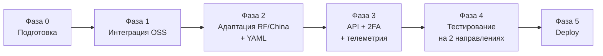

# AetherOrbis — Роадмап

Фазы подготовки, интеграции и вывода MVP. Оценки даны с буфером: исходные оптимистичные оценки
4–7 дней на фазу зафиксированы в SSOT как риск, рабочий ориентир — ~10 дней с буфером.

Каждая задача фаз 1–5 имеет соответствующий GitHub Issue со связями `blocked by` / `blocks`;
реестр — в таблице [«Задачи и зависимости»](#задачи-и-зависимости). Задачи фазы 0 отдельных issue
не имеют: они закрываются подготовительным issue
[#1](https://github.com/G-Ivan-A/aether-orbis/issues/1) и соответствующим PR.

## Обзор фаз

## Фаза 0 — Подготовка

**Цель:** закрыть подготовительный R&D и получить репозиторий, по которому можно начинать работу.

| Задача | Результат |
| --- | --- |
| T0.1 Структура репозитория по архетипу Spoke Хаба | дерево каталогов, root-артефакты, CI |
| T0.2 Документы уровней 1–2 | `docs/vision.md`, `docs/concept.md`, `docs/architecture.md` |
| T0.3 ADR уровня 4 | ADR-001, ADR-002, ADR-003 |
| T0.4 Контракты уровня 4 | четыре контракта в `docs/standards/` |
| T0.5 Роадмап и задачи | `docs/roadmap.md` + GitHub Issues со связями |

**Definition of Done:** структура соответствует архетипу; документы L1–L4 созданы и заполнены;
контракты и ADR соответствуют SSOT v4.3; issues созданы; PR готов к ревью.

**Статус:** завершена; ADR-001…ADR-003 остаются `proposed`, ADR-004…ADR-006 приняты, основа
репозитория создана.

## Фаза 1 — Интеграция open-source

**Цель:** подтвердить исполнимость единого acquisition pipeline на двух моделях — `AM-1 Domain
Monitoring` и `AM-2 Entity / Relationship Extraction` — с конфигурируемыми четырьмя точками
вариативности.

**Ограничения Фазы 1:** `source_group_id` формируется только по `canonical_url` или точному
`content_hash`; `observation_history` принимает только значение `latest_only`; профиль `archival`
применяется только при явном указании в конфигурации.

| Задача | Результат | Статус |
| --- | --- | --- |
| P1-A Контракты и исполнимые Research Specifications ([#35](https://github.com/G-Ivan-A/aether-orbis/issues/35)) | схемы и контракты v1.0, валидируемые профили AM-1/AM-2, примеры выразимости AM-1…AM-5 | завершена |
| P1-B Acquisition core ([#36](https://github.com/G-Ivan-A/aether-orbis/issues/36)) | ingestion, extraction, evaluation и preservation из Research Specification | завершена |
| P1-C Persistence, orchestration и end-to-end доказательство ([#37](https://github.com/G-Ivan-A/aether-orbis/issues/37)) | graph/vector representations, Research Run и сквозные прогоны AM-1/AM-2 | завершена |

**P1-A Definition of Done:** контракты согласованы с ADR-004/005/006; положительные и негативные
fixtures, два исполняемых профиля, отдельный runtime-конфиг и пять аналитических примеров проходят
CI. Реализация ingestion, LLM, persistence и end-to-end прогона остаётся в P1-B/P1-C.

**P1-C Definition of Done:** эксперимент по графовому хранилищу воспроизводим из `experiments/`, его
результаты и ограничения зафиксированы в
[`analysis/2026-09-10-graph-store-selection.md`](analysis/2026-09-10-graph-store-selection.md);
граф и вектор индексируют один поток независимо; Research Run — отдельная сущность с версиями,
хэшами, решениями, итерациями и бюджетом; каждый прогон завершается одним из пяти статусов;
сквозные прогоны AM-1/AM-2 выполняются одной командой без сети и секретов и входят в CI.

**Definition of Done всей Фазы 1 — выполнено:** прогон от источника до контекста проходит целиком
(`examples/research-runs/local_research_run.py`, см.
[`running-locally.md`](running-locally.md)); выдача Extraction проходит валидацию по
[`extraction-contract`](standards/extraction-contract.md); выбор графовой БД зафиксирован в
[ADR-001](adr/2026-08-adr-001-tech-stack.md), пункт 2.

**Статус:** завершена. P1-A, P1-B и P1-C закрыты; сквозные прогоны AM-1 и AM-2 входят в CI
(`.github/workflows/ci.yml`, шаг «Run AM-1 and AM-2 end to end»).

**Открытые риски фазы:** качество извлечения измерено только на оффлайн-фикстурах со словарным
адаптером — оценка на реальных моделях переносится в [T2.3](https://github.com/G-Ivan-A/aether-orbis/issues/11).

## Фаза 2 — Адаптация под модели РФ/Китая и YAML-конфигурации

**Цель:** сделать пайплайн независимым от конкретного провайдера и конфигурируемым по направлениям.

| Задача | Результат |
| --- | --- |
| T2.1 Model Router поверх LiteLLM | вызовы моделей только через Router |
| T2.2 Подключение моделей РФ (YandexGPT, GigaChat) и Китая (Qwen, DeepSeek) | рабочие профили провайдеров |
| T2.3 Evaluation качества извлечения на целевых моделях | отчёт и пороги приемлемости |
| T2.4 YAML-конфигурации направлений | добавление направления без изменения кода |
| T2.5 Кэширование и batch API на cost-sensitive ролях | подтверждённое снижение стоимости |

**Definition of Done:** смена модели для роли выполняется конфигурацией; evaluation показывает
приемлемое качество извлечения на моделях РФ/Китая; второе направление добавляется YAML-конфигом.

### Спринт 1 «Первый пилот техразведки»

**Story.**

Как заказчик, выбирающий подход к конкретной технологической задаче, хочу получить краткий отчёт
с применимыми практиками и проверяемыми первоисточниками, чтобы сравнить его с ручным поиском и
решить, стоит ли заказывать повторный прогон.

Фаза 2 может начаться сразу, с Router и YAML на фикстурах
и параллельной подготовкой ограниченного источника. В одном и том же образе можно запускать
отдельные экземпляры с приватными конфигурациями, данными и секретами заказчиков.

**Цель.** Довести один AM-1-прогон до решения заказчика о повторе в его отдельном контуре.

**Критерий закрытия.** Один допущенный живой прогон с проверенным отчётом, измерением
времени и фактической стоимости относительно ручного процесса и решением заказчика о повторе.
Кейс, бюджет и пороги согласуются до запуска. Допуск включает источник, атрибуцию, модельный
маршрут, изоляцию и обращение с D2, если он нужен. Если конкретный поток не проходит проверку,
владелец может согласовать разрешённый корпус, модель в РФ или ручную проверку соответствующего
шага. При недоступности условий для живого прогона спринт остаётся открытым.
[Обоснование и критерии допуска](https://github.com/G-Ivan-A/aether-orbis/blob/main/docs/analysis/2026-11-22-customer-pilot-readiness.md).

| ID | Название | Приоритет | Зависимости | Статус | Issue | Источник | Краткое содержание | Режим запуска |
| --- | --- | --- | --- | --- | --- | --- | --- | --- |
| B-001 | Подтверждённый оффлайн-прогон | null | - | DONE | [#37](https://github.com/G-Ivan-A/aether-orbis/issues/37), [#41](https://github.com/G-Ivan-A/aether-orbis/issues/41) | [Фаза 1](https://github.com/G-Ivan-A/aether-orbis/blob/main/docs/roadmap.md#фаза-1--интеграция-open-source) | AM-1/AM-2 на фикстурах, границы проверены | null |
| B-002 | Проекты общего хоста и гибрида | null | - | DONE | [#44](https://github.com/G-Ivan-A/aether-orbis/issues/44), [#46](https://github.com/G-Ivan-A/aether-orbis/issues/46) | [PR #45](https://github.com/G-Ivan-A/aether-orbis/pull/45), [PR #47](https://github.com/G-Ivan-A/aether-orbis/pull/47) | Предложения опубликованы, статус ADR/RFC остаётся `proposed` | null |
| B-003 | Сверка требований и обновление предложений | P1 | B-001, B-002 | DONE | [#48](https://github.com/G-Ivan-A/aether-orbis/issues/48), [#50](https://github.com/G-Ivan-A/aether-orbis/issues/50) | [PR #49](https://github.com/G-Ivan-A/aether-orbis/pull/49) | Рекомендация о старте фазы 2 и маршрут пилота приняты | Creative |
| B-004 | Model Router (T2.1) | null | B-001 | DONE | [#9](https://github.com/G-Ivan-A/aether-orbis/issues/9) | [Постановка и приёмка](analysis/2026-11-22-phase-2-pilot-foundations.md#b-004--model-router) | Выбор маршрута по роли и допуск модельного запроса проверены на имитации | Hybrid |
| B-005 | YAML-профиль (T2.4) | null | B-001 | DONE | [#12](https://github.com/G-Ivan-A/aether-orbis/issues/12) | [Постановка и приёмка](analysis/2026-11-22-phase-2-pilot-foundations.md#b-005--yaml-профили-направлений) | Два направления запускаются одной командой по YAML | Hybrid |
| B-006 | Ограниченный HTTP/RSS для AM-1 | null | B-001 | DONE | [#51](https://github.com/G-Ivan-A/aether-orbis/issues/51) | [Постановка и приёмка](analysis/2026-11-22-phase-2-pilot-foundations.md#b-006--httprss-для-am-1) | Манифест и опциональный RSS проверены на фикстурах | Hybrid |
| B-007 | Допуск и прогон для одного заказчика | null | B-004, B-005, B-006 | TODO | [#52](https://github.com/G-Ivan-A/aether-orbis/issues/52) | [Оценка пилота](https://github.com/G-Ivan-A/aether-orbis/blob/main/docs/analysis/2026-11-22-customer-pilot-readiness.md), [методика T2.3](https://github.com/G-Ivan-A/aether-orbis/issues/11) | Закрытый запуск, проверка результата и решение о повторе | Hybrid |

Для B-007 достаточно проверки целевого модельного маршрута по методике T2.3. Общий сравнительный
прогон T2.3 и широкая валидация фазы 4 идут по своим задачам. B-003 закрыт слиянием PR #49.
Результаты B-004…B-006 интегрированы в `main` через [PR #53](https://github.com/G-Ivan-A/aether-orbis/pull/53).
Следующий шаг B-007 включает допуск к живому прогону и проверку результата на кейсе заказчика.

К следующим задачам возвращаемся по наблюдаемым условиям:

| Возможность | Условие пересмотра |
| --- | --- |
| Replay после смены политики | Заказчик назвал набор исторических решений, стоимость пересмотра оправдана, артефакты и права достаточны. Отдельный явный прогон с бюджетом, версиями политики и исходов |
| Универсальный поиск, другие площадки и браузер | Согласованный корпус и RSS систематически пропускают полезные источники. Сначала измерить недостающее покрытие |
| Job API, n8n и общий хост | Появился реальный вызывающий сервис, регулярное расписание или второй проект. Для общего хоста применить требования ADR-007, для сервисных клиентов рассмотреть ADR-008 |
| Профили людей, контакты и outreach | Подтверждена ценность отдельного сценария. До живых действий согласованы цель, основание, условия источника и модель доступа |
| Внешний вычислительный узел, E или H1+ | Замеры показали потребность. Сначала провести аудит фактического потока, определить допустимые классы и получить отдельные решения для E/H1+ |
| SaaS, SLA, расширение телеметрии и разделение сервисов | Есть повторяемая оплачиваемая задача или измеренная проблема изоляции, надёжности или производительности |

## Фаза 3 — API, 2FA и телеметрия

**Цель:** сделать систему наблюдаемой и доступной потребителю.

| Задача | Результат |
| --- | --- |
| T3.1 Квалификация материала по контракту на целевых моделях ([relevance-gate-contract](standards/relevance-gate-contract.md)) | `EvaluationResult`, `QualificationDecision` и Preserved Records вне оффлайн-фикстур |
| T3.2 Реализация Sufficiency Gate по контракту | `SUFFICIENT` / `PARTIAL` / `ZERO` / `CONFLICT` / `EXHAUSTED` с объяснением |
| T3.3 Телеметрия по контракту | события на каждом переходе, сводка прогона |
| T3.4 Публичный API на FastAPI | эндпоинты запуска прогона и получения контекста |
| T3.5 Обязательная 2FA (TOTP или IAM) | защищённый доступ |
| T3.6 Точки human-in-the-loop (заглушки) | логируемые события `hitl` |

Ядро обоих переходов исполняется с фазы 1 (`src/aether_orbis/evaluation.py`,
`src/aether_orbis/sufficiency.py`); T3.1–T3.2 доводят их до работы на целевых моделях и внешнем
контуре, а не создают с нуля.

**Definition of Done:** оба gate работают по контрактам; телеметрия пишется по каждому переходу;
публичные эндпоинты недоступны без второго фактора.

## Фаза 4 — Тестирование на двух направлениях

**Цель:** подтвердить масштабируемость на конфигурации, а не на коде.

| Задача | Результат |
| --- | --- |
| T4.1 Направление «Репутационные технологии (GRA)» | прогон и отчёт |
| T4.2 Направление «Анализ практик Хаба (Habr)» | прогон и отчёт |
| T4.3 Тест явного `ZERO` при недостаточном контексте | негативный тест в CI |
| T4.4 Сверка стоимости прогона с бюджетом | отчёт по телеметрии |

**Definition of Done:** оба направления отработали на одной кодовой базе, различаясь только YAML;
`ZERO` воспроизводимо возвращается при искусственно обеднённом сборе; фактическая стоимость известна.

## Фаза 5 — Развёртывание

**Цель:** вывести систему в целевую инфраструктуру по ADR-003.

| Задача | Результат |
| --- | --- |
| T5.1 Serverless-развёртывание вычислительных шагов | рабочие воркеры |
| T5.2 VPS для состояния (graph, vector, raw, observability) | развёрнутые хранилища |
| T5.3 Управление секретами и переменными `AETHER_ORBIS_*` | секреты вне репозитория |
| T5.4 Резервное копирование Raw / Source Store | проверенное восстановление |
| T5.5 Проверка соответствия юрисдикции и границы репозиторий/runtime | чек-лист перед релизом |

**Definition of Done:** прогон запускается в целевой инфраструктуре; runtime-данные отсутствуют в
git; восстановление из резервной копии проверено.

### Предлагаемая редакция фазы 5 (при принятии ADR-007 / ADR-008)

Issue [#44](https://github.com/G-Ivan-A/aether-orbis/issues/44) меняет целевую среду: один VPS на
несколько ИИ-проектов вместо serverless-first. Пока
[ADR-007](adr/2026-10-adr-007-multi-project-deployment-topology.md) и
[ADR-008](adr/2026-10-adr-008-inter-project-api-contract.md) в статусе `proposed`, действует таблица
выше; при их принятии она заменяется этой.

| Задача | Изменение | Результат |
| --- | --- | --- |
| T5.0 Платформа общего хоста (вне репозитория AetherOrbis, ADR-007 п. 8) | новая | хост, reverse proxy, мониторинг триггеров, бэкап — до заезда первого проекта |
| T5.1 Контейнерный сервис AetherOrbis на общем хосте | заменяет serverless | сервис в лимитах ADR-007 п. 4 (5 GB / 3 vCPU / 50 GB) |
| T5.2 Хранилища состояния в контуре проекта | уточнение | graph, vector, raw в своём томе; Langfuse — по триггеру T-OBS |
| T5.3 Секреты и переменные `AETHER_ORBIS_*` | без изменений | секреты вне репозитория, раздельные по проектам (I-6) |
| T5.4 Бэкап всех измерений ADR-004 и Research Run | расширение объёма | шифрование на клиенте, второе хранилище в РФ, проверенное восстановление, RPO/RTO ≤ 24 ч |
| T5.5 Соответствие юрисдикции, классам данных и изоляции | расширение | чек-лист Compliance ADR-007 и ADR-008 |

Таблица относится к общему хосту. T5.0 запускается при подтверждённом спросе второго проекта и
назначении оператора платформы. Job API по ADR-008 п. 13
([T3.4](https://github.com/G-Ivan-A/aether-orbis/issues/17)) нужен для интеграции сервисов,
воспроизводимая сборка ([#43](https://github.com/G-Ivan-A/aether-orbis/issues/43)) — для
детерминированного релиза. Пилот с операторским запуском допускает закреплённую ревизию и
фиксированное окружение на отдельном узле РФ.

### Дополнение к фазе 5 (при принятии ADR-009)

Issue [#46](https://github.com/G-Ivan-A/aether-orbis/issues/46) добавляет к фазе 5 гибрид H1 и
анонимизацию на границе ([ADR-009](adr/2026-10-adr-009-edge-anonymization-and-lean-hybrid.md),
[RFC](rfc/2026-10-lean-global-compliance.md)). Задачи дополняют, а не заменяют таблицу выше:

| Задача | Результат |
| --- | --- |
| T5.6 Организационные меры перед живой обработкой | проверка правил источников и Q-L2, фиксация основания, политики, применимых уведомлений и правил выпуска отчёта |
| T5.7 Узел РФ и граница анонимизации | сбор и записи об отдельных людях в РФ, контакты маскируются перед LLM, экспорт проверяется и блокируется при сомнении. Полная граница G0–G8 для сценария персонального графа |
| T5.8 Поток отказа и удаления | при хранении D2 проверка отказа до записи, удаление, восстановление без удалённых данных, применимые сроки 3 / 10 рабочих дней |
| T5.9 Зарубежный вычислительный узел (опционально) | подтверждённая потребность и D1-A, внешние E только после отдельного допуска Q-L1 |

Применимые меры T5.6–T5.8 проверяются до первого живого прогона в [#52](https://github.com/G-Ivan-A/aether-orbis/issues/52)
и повторяются при изменении источников, цели или маршрута. Работы фазы 2 на фикстурах идут параллельно.

## Задачи и зависимости

| Задача | Issue | Blocked by | Blocks |
| --- | --- | --- | --- |
| T0.1 | закрыта настоящим PR | — | T0.2 |
| T0.2 | закрыта настоящим PR | T0.1 | T0.3, T0.4 |
| T0.3 | закрыта настоящим PR | T0.2 | [P1-A](https://github.com/G-Ivan-A/aether-orbis/issues/35) |
| T0.4 | закрыта настоящим PR | T0.2 | [P1-A](https://github.com/G-Ivan-A/aether-orbis/issues/35), [T3.1](https://github.com/G-Ivan-A/aether-orbis/issues/14), [T3.2](https://github.com/G-Ivan-A/aether-orbis/issues/15), [T3.3](https://github.com/G-Ivan-A/aether-orbis/issues/16) |
| T0.5 | закрыта настоящим PR | T0.2 | [P1-A](https://github.com/G-Ivan-A/aether-orbis/issues/35) |
| P1-A | [#35](https://github.com/G-Ivan-A/aether-orbis/issues/35) | T0.3, T0.4, T0.5 | [P1-B](https://github.com/G-Ivan-A/aether-orbis/issues/36) |
| P1-B | [#36](https://github.com/G-Ivan-A/aether-orbis/issues/36) | [P1-A](https://github.com/G-Ivan-A/aether-orbis/issues/35) | [P1-C](https://github.com/G-Ivan-A/aether-orbis/issues/37) |
| P1-C | [#37](https://github.com/G-Ivan-A/aether-orbis/issues/37) | [P1-B](https://github.com/G-Ivan-A/aether-orbis/issues/36) | [T2.1](https://github.com/G-Ivan-A/aether-orbis/issues/9), [T2.4](https://github.com/G-Ivan-A/aether-orbis/issues/12), [T5.2](https://github.com/G-Ivan-A/aether-orbis/issues/25) |
| T2.1 | [#9](https://github.com/G-Ivan-A/aether-orbis/issues/9) | [P1-C](https://github.com/G-Ivan-A/aether-orbis/issues/37) | [T2.2](https://github.com/G-Ivan-A/aether-orbis/issues/10), [T2.5](https://github.com/G-Ivan-A/aether-orbis/issues/13) |
| T2.2 | [#10](https://github.com/G-Ivan-A/aether-orbis/issues/10) | [T2.1](https://github.com/G-Ivan-A/aether-orbis/issues/9) | [T2.3](https://github.com/G-Ivan-A/aether-orbis/issues/11) |
| T2.3 | [#11](https://github.com/G-Ivan-A/aether-orbis/issues/11) | [T2.2](https://github.com/G-Ivan-A/aether-orbis/issues/10) | [T3.1](https://github.com/G-Ivan-A/aether-orbis/issues/14) |
| T2.4 | [#12](https://github.com/G-Ivan-A/aether-orbis/issues/12) | [P1-C](https://github.com/G-Ivan-A/aether-orbis/issues/37) | [T4.1](https://github.com/G-Ivan-A/aether-orbis/issues/20), [T4.2](https://github.com/G-Ivan-A/aether-orbis/issues/21) |
| T2.5 | [#13](https://github.com/G-Ivan-A/aether-orbis/issues/13) | [T2.1](https://github.com/G-Ivan-A/aether-orbis/issues/9) | [T4.4](https://github.com/G-Ivan-A/aether-orbis/issues/23) |
| T3.1 | [#14](https://github.com/G-Ivan-A/aether-orbis/issues/14) | T0.4, [T2.3](https://github.com/G-Ivan-A/aether-orbis/issues/11) | [T3.2](https://github.com/G-Ivan-A/aether-orbis/issues/15) |
| T3.2 | [#15](https://github.com/G-Ivan-A/aether-orbis/issues/15) | [T3.1](https://github.com/G-Ivan-A/aether-orbis/issues/14) | [T3.4](https://github.com/G-Ivan-A/aether-orbis/issues/17), [T4.3](https://github.com/G-Ivan-A/aether-orbis/issues/22) |
| T3.3 | [#16](https://github.com/G-Ivan-A/aether-orbis/issues/16) | T0.4 | [T3.4](https://github.com/G-Ivan-A/aether-orbis/issues/17), [T4.4](https://github.com/G-Ivan-A/aether-orbis/issues/23) |
| T3.4 | [#17](https://github.com/G-Ivan-A/aether-orbis/issues/17) | [T3.2](https://github.com/G-Ivan-A/aether-orbis/issues/15), [T3.3](https://github.com/G-Ivan-A/aether-orbis/issues/16) | [T3.5](https://github.com/G-Ivan-A/aether-orbis/issues/18), [T5.1](https://github.com/G-Ivan-A/aether-orbis/issues/24) |
| T3.5 | [#18](https://github.com/G-Ivan-A/aether-orbis/issues/18) | [T3.4](https://github.com/G-Ivan-A/aether-orbis/issues/17) | [T5.1](https://github.com/G-Ivan-A/aether-orbis/issues/24) |
| T3.6 | [#19](https://github.com/G-Ivan-A/aether-orbis/issues/19) | [T3.2](https://github.com/G-Ivan-A/aether-orbis/issues/15) | — |
| T4.1 | [#20](https://github.com/G-Ivan-A/aether-orbis/issues/20) | [T2.4](https://github.com/G-Ivan-A/aether-orbis/issues/12), [T3.2](https://github.com/G-Ivan-A/aether-orbis/issues/15) | [T4.4](https://github.com/G-Ivan-A/aether-orbis/issues/23) |
| T4.2 | [#21](https://github.com/G-Ivan-A/aether-orbis/issues/21) | [T2.4](https://github.com/G-Ivan-A/aether-orbis/issues/12), [T3.2](https://github.com/G-Ivan-A/aether-orbis/issues/15) | [T4.4](https://github.com/G-Ivan-A/aether-orbis/issues/23) |
| T4.3 | [#22](https://github.com/G-Ivan-A/aether-orbis/issues/22) | [T3.2](https://github.com/G-Ivan-A/aether-orbis/issues/15) | [T5.5](https://github.com/G-Ivan-A/aether-orbis/issues/28) |
| T4.4 | [#23](https://github.com/G-Ivan-A/aether-orbis/issues/23) | [T4.1](https://github.com/G-Ivan-A/aether-orbis/issues/20), [T4.2](https://github.com/G-Ivan-A/aether-orbis/issues/21), [T3.3](https://github.com/G-Ivan-A/aether-orbis/issues/16), [T2.5](https://github.com/G-Ivan-A/aether-orbis/issues/13) | [T5.5](https://github.com/G-Ivan-A/aether-orbis/issues/28) |
| T5.1 | [#24](https://github.com/G-Ivan-A/aether-orbis/issues/24) | [T3.4](https://github.com/G-Ivan-A/aether-orbis/issues/17), [T3.5](https://github.com/G-Ivan-A/aether-orbis/issues/18) | [T5.3](https://github.com/G-Ivan-A/aether-orbis/issues/26) |
| T5.2 | [#25](https://github.com/G-Ivan-A/aether-orbis/issues/25) | [P1-C](https://github.com/G-Ivan-A/aether-orbis/issues/37) | [T5.4](https://github.com/G-Ivan-A/aether-orbis/issues/27) |
| T5.3 | [#26](https://github.com/G-Ivan-A/aether-orbis/issues/26) | [T5.1](https://github.com/G-Ivan-A/aether-orbis/issues/24) | [T5.5](https://github.com/G-Ivan-A/aether-orbis/issues/28) |
| T5.4 | [#27](https://github.com/G-Ivan-A/aether-orbis/issues/27) | [T5.2](https://github.com/G-Ivan-A/aether-orbis/issues/25) | [T5.5](https://github.com/G-Ivan-A/aether-orbis/issues/28) |
| T5.5 | [#28](https://github.com/G-Ivan-A/aether-orbis/issues/28) | [T4.3](https://github.com/G-Ivan-A/aether-orbis/issues/22), [T4.4](https://github.com/G-Ivan-A/aether-orbis/issues/23), [T5.3](https://github.com/G-Ivan-A/aether-orbis/issues/26), [T5.4](https://github.com/G-Ivan-A/aether-orbis/issues/27) | — |

## Реестр рисков

| Риск | Митигация |
| --- | --- |
| Scope creep | границы зафиксированы в `docs/vision.md`, расширение — через RFC |
| Слишком тяжёлая инфраструктура на старте | для пилота рекомендован отдельный узел РФ и один операторский воркер; выбор графового хранилища обоснован [измерениями](analysis/2026-09-10-graph-store-selection.md) |
| Недостаточная валидация качества извлечения на моделях РФ/Китая | T2.3 evaluation с порогами |
| Отсутствие quality gates между этапами | оба gate закреплены контрактами; квалификация и Sufficiency Gate исполняются с фазы 1 |
| Слепое доверие OSS-решениям | внешние зависимости изолированы портами `src/aether_orbis/ports.py`; выбор кандидатов обоснован в [`analysis/2026-09-10-acquisition-oss-candidates.md`](analysis/2026-09-10-acquisition-oss-candidates.md) |
| Качество извлечения подтверждено только на оффлайн-фикстурах | evaluation на целевых моделях в [T2.3](https://github.com/G-Ivan-A/aether-orbis/issues/11) с порогами приемлемости |
| Оптимистичные оценки сроков | планирование по ~10 дней на фазу с буфером |
| Один проект на общем хосте исчерпывает RAM и роняет соседей (OOM) | жёсткие лимиты на контейнер, `oom_score_adj`, триггеры T-RAM / T-OOM ([ADR-007](adr/2026-10-adr-007-multi-project-deployment-topology.md) п. 4, 7) |
| Блокировка аккаунта или платежей у зарубежного провайдера (гибрид C2) | ступень 0 целиком в РФ; зарубежный хост — только для D0/D1 и только по триггеру |
| Нарушение локализации ПДн (ч. 5 ст. 18 152-ФЗ) | классы данных ADR-007 п. 3: D2 — только в РФ, первичная запись в РФ; юридическая проверка до приёма ПДн |
| Обработка публичных профессиональных упоминаний без основания | Q-L2 перед живым потоком: оценка п. 7 и п. 9 ст. 6 ч. 1 для конкретной цели и операции, ограничения площадки и выдачи ([ADR-009](adr/2026-10-adr-009-edge-anonymization-and-lean-hybrid.md) п. 1, 4) |
| Идентификаторы просачиваются в агрегаты, промпты LLM или на зарубежный узел | двойная проверка G3 + G7, allowlist-схема экспорта, k ≥ 5, карантин (ADR-009 п. 4) |
| Требование субъекта не исполнено в срок (3 / 10 рабочих дней) | реестр отказов до записи, tombstones, крипто-удаление, метрики сроков (ADR-009 п. 5–6) |
| Расширение продукта на контакты, outreach или продажу данных | триггеры T-CONTACT / T-SELL / T-PROFILE с проверкой юристом (ADR-009 п. 8) |

## Связанные артефакты

- [`docs/vision.md`](vision.md), [`docs/concept.md`](concept.md), [`docs/architecture.md`](architecture.md)
- [`docs/adr/README.md`](adr/README.md)
- [`docs/standards/`](standards/)
